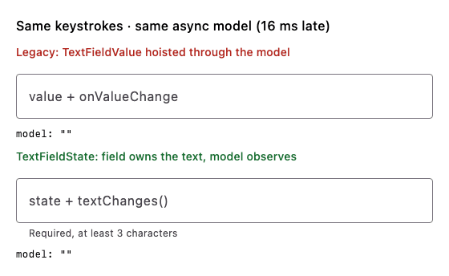

# Decision record: TextFieldState support

**Status:** accepted · **Since:** the release after 1.12.1 / 1.13.0-alpha01 · **Scope:** additive on every channel, plus deprecations in the Compose 1.13+ artifacts

Compose is moving editable text from the `value` + `onValueChange` pair (`String` /
`TextFieldValue`, `VisualTransformation`) to a field-owned
[`TextFieldState`](https://developer.android.com/develop/ui/compose/text/user-input) with
`InputTransformation` / `OutputTransformation` for formatting. yakcov supports both side by side:
every `TextFieldValue` API keeps working, and both kinds mix in one `validate()`, so an app can migrate
one field or module at a time. In the **Compose 1.13+ artifacts** the `value`/`onValueChange`
wrappers are `@Deprecated` (warning level), matching Compose itself; see
[Deprecation](#deprecation-compose-113).

## Why: text that round-trips through a model loses input

With `value` + `onValueChange`, the field renders whatever the model holds. If the model updates
**later** than the next key arrives (a store hop, a reducer on another dispatcher, a slow frame),
every late write resets the field's edit buffer to stale text. Keystrokes are lost and a mid-text
paste lands in the wrong place. A `TextFieldState` field owns its text on the Compose clock, and
the model only **observes** it. Nothing writes the model back into the field while the user types.



*Both fields get the same keystroke on the same frame, every 10 ms, and feed the same model that
applies each change 16 ms late. Rendered on the JVM with Compose's desktop runtime by
`SkippedInputDemoRender` (regenerate with
`YAKCOV_DEMO_OUT=/tmp/demo ./gradlew :library:jvmTest --tests '*SkippedInputDemoRender*' --rerun`).*

Measured with the same keystrokes and the same async model (each change reduced 16 ms late):

| Run | Legacy `TextFieldValue` hoist | `TextFieldState` + `textChanges()` |
|---|---|---|
| JVM UI test, 19 chars at 10 ms gaps (`AsyncModelInputTest`) | `teqikbonfx` (9/19 kept) | exact |
| Android emulator, `adb input text` (43 chars), run 1 | `qikbrwn fjm e t laog` | exact |
| Android emulator, run 2 | `the quick brop azog` | exact |
| Mid-text paste / caret edit | lands wrong (test control) | lands at the caret, caret preserved |

The demo is `SkippedInputActivity` in `:sample` (it has a model-lag slider):
`adb shell am start -n com.chrisjenx.yakcov.sample/.SkippedInputActivity`.

**The rule this record follows throughout:** the `TextFieldState` is the only writer of a field's
text while the user is typing. The model is downstream of it, and the only model → field write is
an explicit, one-shot re-seed (§4).

## What ships

| API | Purpose |
|---|---|
| `TextFieldStateValidator` / `rememberTextFieldStateValidator` | Validator-owns-state over a `TextFieldState`. Same rules, members and error timing as `TextFieldValueValidator`. |
| `Modifier.onFocusCursorToEnd(state: TextFieldState, highlight)` | Caret to end (or select all) on focus, through the state's own selection. The validator has the same member. |
| `TextFieldState.textChanges(): Flow<String>` | The state → Model hand-off for reducer (UDF) forms. Emits text only, never caret moves. |
| `validationBehavior`, `shakeOnInvalid`, `onFocusLost`, `validationConfig(validator)` | **Unchanged.** They never took a value, so they already work with `TextFieldState` fields. |

`TextFieldStateValidator` extends `ValueValidator<String, String>`, so it mixes with
`TextFieldValueValidator` in one `listOf(a, b).validate()` and keeps `isValid`, `isError()`,
`supportingText()`, `validate()`, `reset()` and the `validationConfig` member exactly as before.

!!! note "Works on every channel"
    `TextFieldState` and its material3 overloads exist on every Compose version yakcov builds
    (1.12.x stable and the 1.13 pre-release line), so the new API ships on **both** channels. You
    do not have to move to Compose 1.13 to start migrating.

## 1. Validator-owns-state

```kotlin
--8<-- "docs-examples/src/commonMain/kotlin/com/chrisjenx/yakcov/docs/textfieldstate/TextFieldStateExample.kt:tfs-validator"
```

**How validation observes the state.** Rules read `textFieldState.text` through a snapshot read,
so `isValid`/`isError()`/`supportingText()` recompute on every edit with no `onValueChange`. The one
thing that needs a running observer is the move from *pristine* to *validating* on the user's first
edit. That is the step `onValueChange` performs today, and it is what makes
`showErrorOnInteraction` meaningful. `observeTextChanges()` does it with
`snapshotFlow { state.text.toString() }`. `rememberTextFieldStateValidator` and the
`validationConfig` modifier both run it while the field is composed. A validator you construct
yourself (for example as a `val` on a component) and use without `validationConfig` must run it:
`LaunchedEffect(v) { v.observeTextChanges() }`, or launch it from the component's scope.

**Error timing is unchanged.** Errors show on blur (`validateOnFocusLost = true`) or submit
(`validate()`). With `showErrorOnInteraction = false` they never show while a fresh field is being
typed into, and after the first blur they update live. `initialValidate = true` still starts
validating immediately, which a field whose starting value is already valid needs (an optional
`Email`, a quantity seeded `"1"`). A pristine field still reports `isValid == false`.

## 2. Modifiers, and who owns the behaviour

`validationBehavior(isError, shakeTrigger, onFocusLost)` and `shakeOnInvalid(isError, trigger)` are
already value-agnostic, so no `TextFieldState` overload is needed. The only value-coupled modifier
was `onFocusCursorToEnd`, which now has a `TextFieldState` overload that edits the selection in
place (`placeCursorAtEnd()` / `selectAll()`). There is no value to hoist and no callback to call.

**Recommendation for a field wrapper** (for example one `AppTextField(state, rules, format, style)`):
the wrapper should *own* these behaviours and apply the yakcov modifiers internally, rather than
asking every call site to chain them. Focus-loss validation, shake on invalid submit and
caret-to-end are properties of "a validated field", not of a screen, and putting them in one place
removes the per-call-site drift. The modifiers stay public as the building blocks, and keeping them
small is what makes them composable in a wrapper.

## 3. UDF forms: what does the Model hold?

The options when the field owns a `TextFieldState`:

| Option | Verdict |
|---|---|
| **a. The `TextFieldState` itself in the Model** | ✗ It is a mutable, reference-identity holder, the same reason a Model never holds validators. `copy()` aliases it, `==` becomes identity, and persistence and time-travel break. |
| **b. An immutable `String` snapshot, kept in sync one way (state → Model)** | ✓ **Recommended.** The reducer is unchanged in shape. |
| **c. An adapter that computes `FieldValidationState` outside the reducer** | ✗ Validation moves out of `reduce()`, and `showError` gets two owners. `textChanges()` is the only adapter worth having: a one-liner that gets the `toString()`/selection detail right. |

The **component** (Decompose component, ViewModel, presenter) owns the `TextFieldState` as a `val`
next to its store. The **Model** holds the text as a `String` plus the field's
`FieldValidationState`. The **reducer** folds rules exactly as today.

```kotlin
--8<-- "docs-examples/src/commonMain/kotlin/com/chrisjenx/yakcov/docs/textfieldstate/TextFieldStateExample.kt:tfs-udf-model"
```

```kotlin
--8<-- "docs-examples/src/commonMain/kotlin/com/chrisjenx/yakcov/docs/textfieldstate/TextFieldStateExample.kt:tfs-udf-component"
```

```kotlin
--8<-- "docs-examples/src/commonMain/kotlin/com/chrisjenx/yakcov/docs/textfieldstate/TextFieldStateExample.kt:tfs-udf-ui"
```

**Compared with today.** `rules.toFieldState(value.text, showError)` becomes
`rules.toFieldState(text, showError)`, and everything else (keystroke events preserve `showError`,
focus-loss and submit force it, `hasNoErrors()` for `canSubmit`, the `submitAttempts` shake counter)
carries over unchanged. The Model's field type shrinks from `TextFieldValue` to `String`, because the
caret now lives in the `TextFieldState`. The rules about seeding and clamping `TextRange` no longer
apply.

**Caveats.**

- The hand-off is asynchronous: the Model catches up on the next snapshot apply, before the next
  frame. A click handler runs as a later event and sees the final text. If an action can fire in
  the same frame as an edit, carry the text in the event: `Submit(amount = amount.text.toString())`.
- `textChanges()` conflates. A burst of edits may arrive as its final text, which is all a reducer
  needs.
- Process death: persist the Model's `String` (it is the source of truth for restore) and re-seed
  the state from it, or use `rememberTextFieldState` / `TextFieldState.Saver` for a UI-owned state.

## 4. Programmatic writes (suggestion, preset, re-seed, clear)

**Write the `TextFieldState`, never the Model.** Writes travel one way: state → Model through
`textChanges()`. `setTextAndPlaceCursorAtEnd` puts the caret at the end, which replaces
`TextFieldValue(text, TextRange(text.length))` helpers such as a "caret-end entry". A new
`TextFieldState(text)` also starts with the caret at the end.

```kotlin
--8<-- "docs-examples/src/commonMain/kotlin/com/chrisjenx/yakcov/docs/textfieldstate/TextFieldStateExample.kt:tfs-writes"
```

| Write | Where it originates | How |
|---|---|---|
| Suggestion pick, preset fill | UI event | `state.setTextAndPlaceCursorAtEnd(text)` in the handler |
| Clear | UI event | `state.clearText()` |
| Re-seed (server load, edit prefill, reset after save) | Reducer | Reducer publishes a versioned `Seed(text, version)` (or a one-shot effect). The UI applies it in `LaunchedEffect(seed.version)` |

**Rejected: the model echo** (`LaunchedEffect(model.text) { if (state.text != model.text) state.set…(model.text) }`).
It loses keystrokes. Type "a" and the Model becomes "a". Type "b" before the effect runs, and the
effect compares the state's "ab" with the Model's stale "a" and writes "a" back. A versioned seed
fires only when the reducer means to write.

**With a validator**, the write path decides whether it counts as user interaction:

- `validator.value = text`: replaces the text, caret at end, **not** interaction. The field stays
  pristine, exactly like assigning `TextFieldValueValidator.value`. Use it for a re-seed, followed
  by `reset()` if the field should look untouched.
- `validator.validate(text)`: replaces the text and shows errors.
- A write straight to the state (`setTextAndPlaceCursorAtEnd`, `clearText`, `edit {}`) cannot be
  told apart from typing, so it **is** interaction. That is right for a suggestion pick.

## 5. Transformations: raw or transformed text?

Rules, `textChanges()` and the Model all see **`TextFieldState.text`**:

- **after** the `InputTransformation`. It runs on user edits (typing, paste, IME) and changes what
  is stored. A digit filter means the validator never sees the rejected characters.
- **before** the `OutputTransformation`. It only changes what is drawn. "12.5" displayed as "12.50"
  is still "12.5" to the rules.
- **Programmatic writes bypass the `InputTransformation`.** `setTextAndPlaceCursorAtEnd("12a")`
  stores "12a". Normalise a preset before writing it.

```kotlin
--8<-- "docs-examples/src/commonMain/kotlin/com/chrisjenx/yakcov/docs/textfieldstate/TextFieldStateExample.kt:tfs-transform"
```

**Reshaping like currency "12.5" → "12.50".** Don't pad in an `InputTransformation`: it rewrites
stored text on every keystroke, fights the caret, and the user can't delete the digit it keeps
re-adding. Use the `InputTransformation` to *restrict* (digits, one dot, `maxLength`). Use an
`OutputTransformation` to *present* (padding, grouping, a currency symbol). Write rules against the
stored, unpadded form. If the stored value itself must be canonical, normalise once on blur with a
programmatic write in the focus-lost handler.

## Deprecation (Compose 1.13+)

Compose 1.13 deprecates `BasicTextField(value, onValueChange, …)` for both `String` and
`TextFieldValue`; 1.11 and 1.12 don't. (Checked in the bytecode: in CMP 1.13.0-beta02 and androidx
material3 1.5.0-rc01 the material3 `TextField`/`OutlinedTextField` value overloads aren't annotated
yet, but the foundation field they wrap is.) yakcov follows the same line. **Only the 1.13+
artifacts** deprecate the wrappers around that shape:

| Deprecated in 1.13+ | Use instead |
|---|---|
| `TextFieldValueValidator` | `TextFieldStateValidator` |
| `rememberTextFieldValueValidator(value: String, …)` | `rememberTextFieldStateValidator(initialText = …)` (IDE quick-fix via `ReplaceWith`) |
| `rememberTextFieldValueValidator(textFieldValue: MutableState<TextFieldValue>, …)` | `rememberTextFieldStateValidator(textFieldState = …)` |
| `Modifier.onFocusCursorToEnd(value, onValueChange, …)` | `Modifier.onFocusCursorToEnd(state = …)` |
| `PasswordMatches(textFieldValueField)` | `PasswordMatches(stringField)` with a `TextFieldStateValidator` |

The level is **warning**, so builds keep compiling while you migrate. Nothing is removed; removal
comes in a later release. Everything not tied to the deprecated field shape is untouched:
`ValueValidator`, the rules, `GenericValueValidator`, `FieldValidator`, `FieldValidationState`,
`validationBehavior`, `shakeOnInvalid` and `onFocusLost`.

**How it's built.** All channels compile one common source set, and Kotlin rejects a typealias to
`kotlin.Deprecated`. So those declarations carry an internal marker, `@TextFieldValueApi(…)`. Before
1.13 it's a source-only no-op. On 1.13+, the `deprecateTextFieldValueApi` Gradle task compiles a
copy of each file that uses it, with the marker rewritten to `@Deprecated(…)`. File names, JVM
facades and the ABI dump don't change.

## Known limitations

- Validation state (pristine/validating/showing errors) is not saveable. This is the same as
  `TextFieldValueValidator`. `rememberTextFieldStateValidator` does save the *text*.
- The pristine → validating step needs the observer running (see §1). Without it, rules still
  evaluate live, but a fresh field won't start validating until blur or submit.

## Tests

`TextFieldStateValidatorTest` (validator, timing, caret, transformations, `textChanges`),
`TextFieldStateUdfTest` (state → Model hand-off, programmatic writes, versioned re-seed, the
submit-counter shake) and `AsyncModelInputTest` (fast typing, mid-text paste and a re-seed under an
async model, each with a legacy control proving the harness detects the loss) run in full on JVM, Wasm and the iOS simulator. Android unit tests and JS
run the pure (non-UI) cases and skip the Compose UI ones, as the rest of the suite does
(`@AndroidJUnitIgnore` / `@JSIgnore`).
